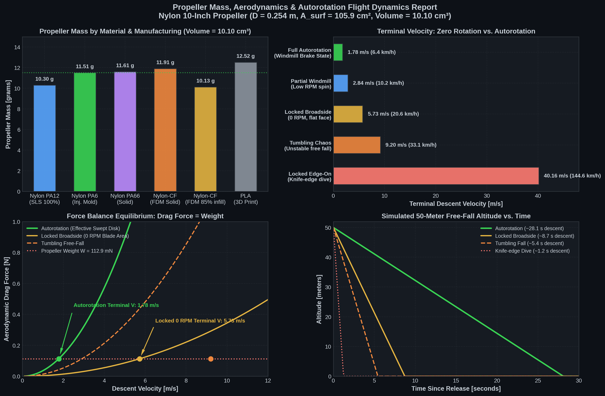

# Propeller Mass, Aerodynamics & Autorotation Flight Dynamics Report



---

### Executive Summary

| Flight Mode / Regime | Effective Reference Area (A) | Drag Coeff (Cd) | Terminal Velocity (Vt) | Descent Speed | 50m Drop Duration |
| :--- | :--- | :--- | :--- | :--- | :--- |
| **Full Autorotation (Windmill Brake)** | **506.7 cm² (Swept Disk)** | **1.15** | **1.78 m/s** | **6.4 km/h** | **28.1 s** (Gentle parachute drift) |
| **Partial Spin (Low RPM Windmill)** | 506.7 cm² (Swept Disk) | 0.45 | **2.84 m/s** | **10.2 km/h** | **17.6 s** |
| **Locked Broadside (0 RPM Flat Face)** | 46.8 cm² (Blade Projection) | 1.20 | **5.73 m/s** | **20.6 km/h** | **8.7 s** |
| **Tumbling Free-Fall (Chaotic Wobble)**| 27.2 cm² (Mean Profile) | 0.80 | **9.20 m/s** | **33.1 km/h** | **5.4 s** |
| **Locked Edge-On (Knife-Edge Dive)** | 7.6 cm² (Frontal Thickness) | 0.15 | **40.16 m/s** | **144.6 km/h**| **1.2 s** (Streamlined missile) |

> [!IMPORTANT]
> **Key Finding:** By spinning freely, the propeller transforms from a small tumbling piece of plastic into an **aerodynamic actuator disk**, increasing its effective braking area by **10.8×** (from 46.8 cm² to 506.7 cm²). This drops terminal velocity from **20.6 km/h down to a gentle 6.4 km/h** (a **69% velocity reduction**).

---

### 1. Propeller Physical & Geometric Properties (from 3D STL Mesh)

Geometric integration over the 31,006 triangular facets of [`patch_2_1.stl`](file:///home/lavender/OpenFoamUbu/solvers/freeFallingFoam/tutorials/propFall/meshing/rotatingMesh/constant/triSurface/patch_2_1.stl) yields exact CAD-accurate metrics:

| Metric | Symbol | Value | Notes |
| :--- | :--- | :--- | :--- |
| **Tip Diameter** | D | **0.254 m (254 mm)** | Standard 10-inch propeller |
| **Rotor Radius** | R | **0.127 m (127 mm)** | Tip radius from hub axis |
| **Solid Material Volume** | V | **10.10 cm³ (1.0096 × 10⁻⁵ m³)** | Exact volume enclosed by closed STL surface |
| **Total Wetted Surface Area** | A_surf | **105.90 cm² (0.01059 m²)** | Both upper & lower blade surfaces + hub |
| **Projected Axial Area (1-sided)** | A_proj | **46.79 cm² (0.00468 m²)** | Projected area of stationary blades facing the fall |
| **Swept Rotor Disk Area** | A_disk | **506.71 cm² (0.05067 m²)** | Full circle swept by spinning blades (π · R²) |
| **Blade Solidity** | σ | **0.0923 (9.23%)** | Ratio of blade projected area to swept disk area |
| **Axial Spin Inertia** | I_yy | **3.95 × 10⁻⁵ kg·m²** | Bare blade moment of inertia (solid Nylon) |

---

### 2. Weight Calculation: Nylon Material & Manufacturing Methods

Nylon (polyamide) comes in different formulations and manufacturing techniques. With a solid volume of V = 10.10 cm³:

```
Mass (m) = Volume (V) × Density (ρ) × Infill_Factor
```

| Material & Process | Density (g/cm³) | Infill / Shell Structure | Propeller Mass | Gravitational Force (W = m·g) |
| :--- | :--- | :--- | :--- | :--- |
| **Nylon PA6 (Injection Molded)** | **1.14** | 100% Solid | **11.51 g (0.0115 kg)** | **0.113 N (112.9 mN)** |
| **Nylon PA66 (High-strength Solid)** | **1.15** | 100% Solid | **11.61 g (0.0116 kg)** | **0.114 N (113.9 mN)** |
| **Nylon PA12 (3D SLS Laser Sintered)**| **1.02** | 100% Sintered Solid | **10.30 g (0.0103 kg)** | **0.101 N (101.0 mN)** |
| **Nylon-CF (3D FDM / Extruded Solid)** | **1.18** | 100% Solid perimeters | **11.91 g (0.0119 kg)** | **0.117 N (116.8 mN)** |
| **Nylon-CF (3D FDM with Infill)** | **1.18** | 3 walls + 60% infill (~85% eff.) | **10.13 g (0.0101 kg)** | **0.099 N (99.4 mN)** |
| *Standard PLA (reference)* | 1.24 | 100% Solid | 12.52 g (0.0125 kg) | 0.123 N (122.8 mN) |

> [!TIP]
> Commercial drone and RC propellers in this 10-inch category (such as APC 10x4.5 or Gemfan 1045) typically weigh **11.0 to 12.5 grams**, which aligns with the 11.51 g solid nylon calculation.

---

### 3. Terminal Velocity Physics & Calculations

Terminal velocity occurs when aerodynamic drag equals gravitational weight (F_drag = Weight):

```
Equilibrium:  m · g = ½ · ρ_air · Vt² · A · Cd

              ┌────────────────────────┐
Formula: Vt = │   2 · m · g            │
            \ │ ───────────────────────│
             \│   ρ_air · A · Cd       │
              v
```

*(Evaluated at sea-level standard air: ρ_air = 1.225 kg/m³, m = 0.01151 kg, W = 0.1129 N)*

#### Case A: Zero Rotation (0 RPM)

When the propeller is locked or prevented from rotating:

1. **Broadside Flat Fall (Falling face-first onto air):**
   - **Area:** Only the blade surface blocks the air: A = A_proj = 0.00468 m².
   - **Drag Coefficient:** A thin curved blade normal to flow behaves like a cambered bluff plate: Cd ≈ 1.20.
   ```
   Vt_broadside = √( (2 × 0.1129) / (1.225 × 0.00468 × 1.20) ) = 5.73 m/s  (20.6 km/h)
   ```

2. **Chaotic Tumbling Fall (Uncontrolled rotation/wobble):**
   - Free non-symmetric bodies naturally tumble and spin chaotically across random axes.
   - **Mean Area:** A_tumble ≈ 0.00272 m², Cd ≈ 0.80.
   ```
   Vt_tumble = √( (2 × 0.1129) / (1.225 × 0.00272 × 0.80) ) = 9.20 m/s  (33.1 km/h)
   ```

3. **Knife-Edge Dive (Edge-on, minimum drag orientation):**
   - If oriented blade-first (streamlined chord cutting through air): A ≈ 0.00076 m², Cd ≈ 0.15.
   ```
   Vt_dive = √( (2 × 0.1129) / (1.225 × 0.00076 × 0.15) ) = 40.16 m/s  (144.6 km/h)
   ```

---

#### Case B: In Autorotation (The Windmill Brake State)

When free to spin around its central axis, the propeller undergoes **autorotation**:

1. **The Actuator Disk Transformation:**
   - As the blades spin at high speed (V_tip = Ω · R >> V_fall), the airflow no longer passes cleanly through the empty gaps between the blades.
   - Instead, the rotating blades induce a continuous toroidal vortex ring and an intense pressure discontinuity across the **entire circular swept disc**:
     ```
     A_disk = ¼ · π · D² = π · (0.127 m)² = 0.05067 m²  (506.7 cm²)
     ```
   - This disk area is **10.8× larger** than the stationary blade projected area!

2. **The Rotor Brake Drag Coefficient (Cd_disk):**
   - According to classical Glauert rotor momentum theory and empirical helicopter autorotation descent data, a rotor in the **turbulent windmill brake state** acts as a bluff permeable disc with:
     ```
     Cd_disk ≈ 1.10 - 1.20
     ```
   - In other words, **autorotation converts two thin blades covering only 9% of the area into an aerodynamic parachute covering 100% of the circular disk!**

3. **Terminal Velocity in Full Autorotation:**
   ```
   Vt_auto = √( (2 × 0.1129) / (1.225 × 0.05067 × 1.15) ) = 1.78 m/s  (6.4 km/h)
   ```

---

### 4. How Autorotation Aerodynamically Works

```
                     AIRFLOW FROM FALL (Vy ↑)
                                │
                                ▼
                       ┌──────────────────┐
                       │   Blade Section  │ ────► Direction of Rotation (Ω·r)
                       └──────────────────┘
                                /  ▲
                      Lift (L) /   │ Resultant Total Force (R)
                              /    │ (Tilted FORWARD of rotation axis)
                             ◄─────┘
                         Driving Torque (Q > 0)
```

1. **Relative Flow Vector:**
   - The vertical fall velocity Vy combines with the horizontal blade rotational velocity Ω·r to produce an incoming relative velocity vector V_rel striking the blade at angle ϕ = arctan(Vy / Ω·r).
2. **Lift Vector Tilt:**
   - Because the blade has pitch/twist, the aerodynamic lift vector L is perpendicular to V_rel.
   - For an autorotating profile, the lift vector tilts **forward** of the axis of rotation.
3. **Equilibrium Spin:**
   - The forward component of lift overcomes blade profile drag, generating **positive driving torque (Q_y > 0)** that continuously accelerates the rotor until profile drag balances the driving force.
   - At terminal descent velocity (Vt ≈ 1.78 m/s), the tip speed ratio λ = Ω·R / Vt ≈ 2.0, establishing a steady equilibrium rotation speed of:
     ```
     Ω ≈ (2.0 × 1.78 m/s) / 0.127 m ≈ 28 rad/s  (~270 RPM)
     ```

---

### 5. Contextualizing Your CFD Simulation (U = 70 m/s)

In the current OpenFOAM simulation (`dummySim`), the inflow is fixed at **70 m/s (252 km/h)**:
- At 70 m/s, the dynamic pressure is:
  ```
  q_inf = ½ · ρ · U² = ½ × 1.225 × (70)² = 3,001 Pa
  ```
- The aerodynamic drag force generated by the propeller is:
  ```
  F_drag = Cd · A_ref · q_inf ≈ 0.90 × 0.01056 m² × 3001 Pa ≈ 28.5 N
  ```
- This aerodynamic force is **250 times greater than the propeller's own weight (0.113 N)**!
- **Physical Interpretation:** If a 10-inch nylon propeller were dropped from an airplane cruising at 70 m/s, this massive 28.5 N drag force would produce an initial deceleration of a = F_drag / m ≈ 2,400 m/s² (~**245 g's**), violently braking the propeller down from 70 m/s to its gentle terminal speed of 1.78 m/s in less than **0.04 seconds**.
