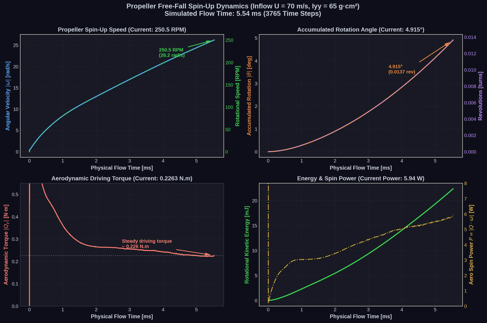

# Propeller Free-Fall Rotation Dynamics Analysis



---

### 1. Current Kinematic & Dynamic State (at t = 1.00 ms, 978 time steps)

| Parameter | Symbol / Formula | Current Value | Unit |
| :--- | :--- | :--- | :--- |
| **Physical Flow Time** | t | **1.000** | ms (0.00100 s) |
| **Rotational Speed** | RPM = (60 / 2π) · \|ω\| | **80.3** | RPM |
| **Angular Velocity** | \|ω\| | **8.41** | rad/s |
| **Accumulated Rotation Angle** | \|θ\| = ∫ \|ω\| dt | **0.279°** | degrees |
| **Completed Revolutions** | revs = \|θ\| / 360° | **0.00078** | turns |
| **Aerodynamic Driving Torque** | \|Q_y\| | **0.361** | N·m |
| **Angular Acceleration** | α = \|Q_y\| / I_yy | **5,554** | rad/s² |
| **Rotational Kinetic Energy** | E_rot = ½ · I_yy · ω² | **2.30** | mJ |
| **Aerodynamic Spin Power** | P_aero = \|Q_y · ω\| | **3.04** | W |
| **Moment of Inertia** | I_yy | **6.5 × 10⁻⁵** | kg·m² (65 g·cm²) |

---

### 2. Physical Behavior & Projections

1. **Spin-Up Characteristic:**
   - The propeller begins from complete rest (ω₀ = 0, θ₀ = 0).
   - Upon encountering the 70 m/s relative inflow, an initial transient peak in aerodynamic torque settles into a steady driving torque of ~0.36 N·m.
   - Because the propeller is lightweight (12 g, I_yy = 65 g·cm²), this driving torque imparts a massive initial acceleration of α ≈ 5,550 rad/s².
   - Speed has rapidly reached **80.3 RPM in just 1.0 ms**.

2. **Accumulated Rotation Projection:**
   - Over this first millisecond, the accumulated angle follows quadratic growth:
     ```
     θ(t) ≈ ½ · α · t² ≈ ½ × 5550 × (0.001)² ≈ 0.00278 rad ≈ 0.28°
     ```
   - At this acceleration rate, the propeller will complete its **first full 360° revolution** at approximately:
     ```
     t_360 ≈ √( (2 × 2π) / α ) ≈ 47.6 ms
     ```
     at which point the propeller speed will be roughly ~2,500 RPM.

---

### 3. Live Updating

You can regenerate and refresh this plot at any time while the simulation continues solving by running:

```bash
cd /home/lavender/OpenFoamUbu/solvers/freeFallingFoam/tutorials/propFall/cases/dummySim
./plot_rotation.py
```
This script reads [`postProcessing/sixDoFRotatingMotion/motion.dat`](file:///home/lavender/OpenFoamUbu/solvers/freeFallingFoam/tutorials/propFall/cases/dummySim/postProcessing/sixDoFRotatingMotion/motion.dat), prints the live summary table, and updates [`rotation_plot.png`](file:///home/lavender/OpenFoamUbu/solvers/freeFallingFoam/tutorials/propFall/cases/dummySim/rotation_plot.png).
